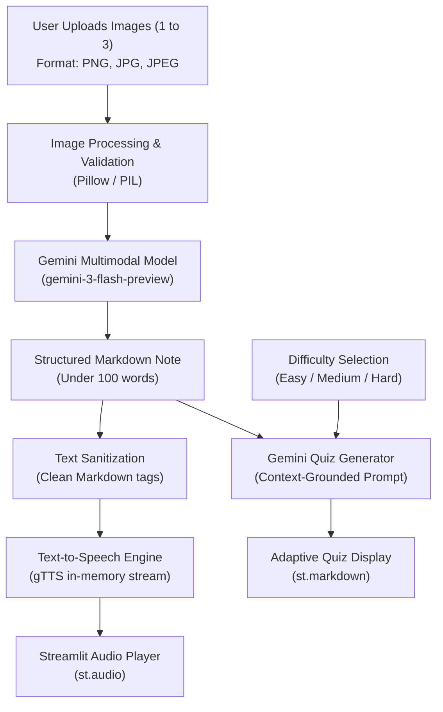

# 📚 AI-Powered Multimodal Study Companion & Quiz Generator

[](https://www.python.org/)
[](https://streamlit.io/)
[](https://ai.google.dev/)
[](LICENSE)

An intelligent, multimodal educational web application developed with **Streamlit** and **Google Gemini API**. The application ingests visual study materials—such as lecture slides, textbook pages, and handwritten notes—and synthesizes them into structured summaries, real-time audio narrations, and difficulty-tailored self-assessment quizzes.

---

## 📖 Table of Contents

- [Overview](#-overview)
- [System Architecture](#-system-architecture)
- [Key Features](#-key-features)
- [Technology Stack](#-technology-stack)
- [Repository Structure](#-repository-structure)
- [Getting Started](#-getting-started)
  - [Prerequisites](#prerequisites)
  - [Installation](#installation)
  - [Environment Setup](#environment-setup)
  - [Running the Application](#running-the-application)
- [Usage Guide](#-usage-guide)
- [API & Prompt Design](#-api--prompt-design)
- [License](#-license)

---

## 🎯 Overview

Reviewing static study images, lecture slides, and notes is often passive and time-consuming. This project bridges visual understanding, natural language processing, and audio synthesis to create an interactive study workflow:

1. **Visual Synthesis:** Extracts information directly from up to 3 study images using Gemini's native vision-language reasoning without needing separate OCR software.
2. **Auditory Learning:** Converts synthesized study notes into clear audio explanations on the fly using in-memory speech synthesis.
3. **Active Recall:** Formulates targeted quizzes matching the user's desired difficulty level (**Easy**, **Medium**, or **Hard**) to reinforce comprehension.

---

## 🏗️ System Architecture



---

## ⚡ Key Features

- **Multimodal Visual Ingestion:** Supports simultaneous upload of up to 3 visual assets in `.jpg`, `.jpeg`, and `.png` formats with automated limit validation.
- **Side-by-Side Image Previews:** Dynamically creates multi-column previews in the sidebar for immediate visual verification.
- **Concise Note Synthesis:** Leverages Google Gemini's multimodal vision model (`gemini-3-flash-preview`) to extract core insights into formatted Markdown notes capped at 100 words.
- **In-Memory Text-to-Speech (TTS):** Sanitizes Markdown formatting and streams generated audio via Python's `io.BytesIO` buffer, delivering low-latency audio without disk read/write overhead.
- **Adaptive Quiz Generation:** Generates contextual questions tailored to user-specified difficulty settings (**Easy**, **Medium**, or **Hard**) to facilitate active recall practice.
- **Clean & Responsive UI:** Built with Streamlit containerized layouts, real-time loading feedback (`st.spinner`), and visual alerts for guided interaction.

---

## 🛠️ Technology Stack

| Layer | Technology | Details |
| :--- | :--- | :--- |
| **Programming Language** | **Python 3.10+** | Core programming language for application logic and API integrations. |
| **Web Framework & UI** | **Streamlit** | Rapid frontend development, multi-column layouts, reactive components, and media players. |
| **Generative AI / LLM** | **Google GenAI SDK** | `gemini-3-flash-preview` model for multimodal vision understanding and contextual text generation. |
| **Speech Synthesis (TTS)** | **gTTS (Google Text-to-Speech)** | Text-to-speech engine for audio explanations. |
| **Image Processing** | **Pillow (PIL)** | Image loading, format handling, and conversion for Gemini multimodal payloads. |
| **Buffer & Stream Handling** | **`io.BytesIO`** | In-memory binary streaming for diskless audio delivery. |
| **Configuration & Security** | **`python-dotenv`** | Secure management of sensitive API credentials via `.env`. |

---

## 📁 Repository Structure

```text
srteamlit_quiz_app_using_gemini/
├── app.py              # Main Streamlit web application & user interface
├── api_calling.py      # Core Gemini API functions (notes, audio, quiz)
├── requirements.txt    # Project dependencies and pinned library versions
├── LICENSE             # MIT License
└── README.md           # Comprehensive project documentation
```

---

## 🚀 Getting Started

### Prerequisites

Ensure you have the following installed on your system:
- **Python 3.10+**
- **pip** (Python package installer)
- A **Google Gemini API Key** (obtainable from [Google AI Studio](https://aistudio.google.com/))

### Installation

1. **Clone the repository:**
   ```bash
   git clone https://github.com/your-username/srteamlit_quiz_app_using_gemini.git
   cd srteamlit_quiz_app_using_gemini
   ```

2. **Create and activate a virtual environment:**
   ```bash
   # On Windows:
   python -m venv venv
   .\venv\Scripts\activate

   # On macOS / Linux:
   python3 -m venv venv
   source venv/bin/activate
   ```

3. **Install dependencies:**
   ```bash
   pip install -r requirements.txt
   ```

### Environment Setup

Create a `.env` file in the root directory:

```env
GEMINI_API_KEY=your_google_gemini_api_key_here
```

### Running the Application

Launch the Streamlit development server:

```bash
streamlit run app.py
```

The web application will open automatically in your browser at `http://localhost:8501`.

---

## 🖥️ Usage Guide

1. **Upload Images:** Navigate to the sidebar and upload 1 to 3 images (lecture slides, notes, diagrams).
2. **Select Difficulty:** Choose your preferred quiz level (**Easy**, **Medium**, or **Hard**).
3. **Click Submit:** Click the **Submit** button to trigger the pipeline.
4. **Review Outputs:**
   - **Notes:** Read the concise, markdown-formatted study notes.
   - **Audio Explanation:** Click play on the embedded audio player to listen to the explanation.
   - **Quiz:** Practice the generated questions to test your understanding.

---

## 🧠 API & Prompt Design

The application utilizes structured prompting across three modular services in [`api_calling.py`](api_calling.py):

- **`note_generator(images)`**: Passes PIL images directly into `client.models.generate_content` with instructions to synthesize visual content into a concise, Markdown-formatted study note (max 100 words).
- **`audio_generarton(text)`**: Cleans formatting markdown characters and passes plain text to `gTTS`, writing binary audio data directly into an `io.BytesIO` buffer.
- **`quiz_generation(text, level)`**: Feeds the synthesized note as context and prompts the model to generate a structured self-test quiz aligned with the chosen difficulty grade.

---

## 📄 License

This project is licensed under the **MIT License** — see the [LICENSE](LICENSE) file for details.
